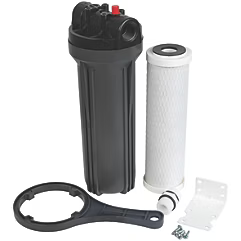
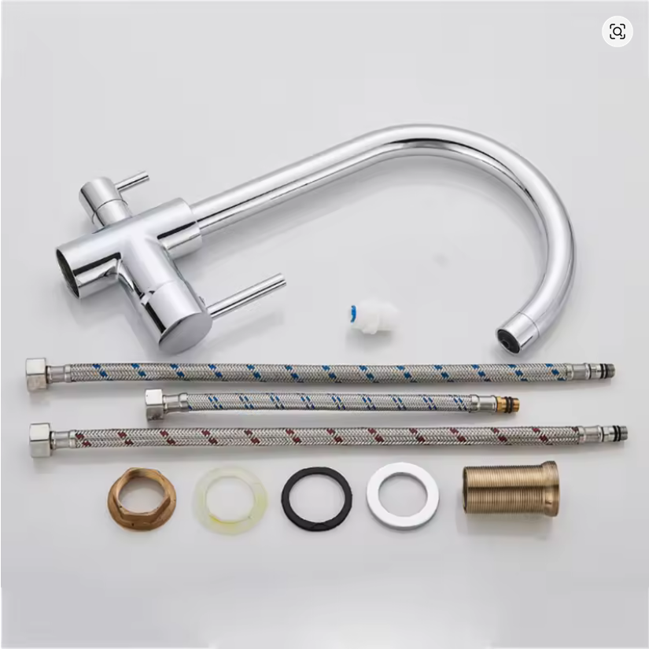
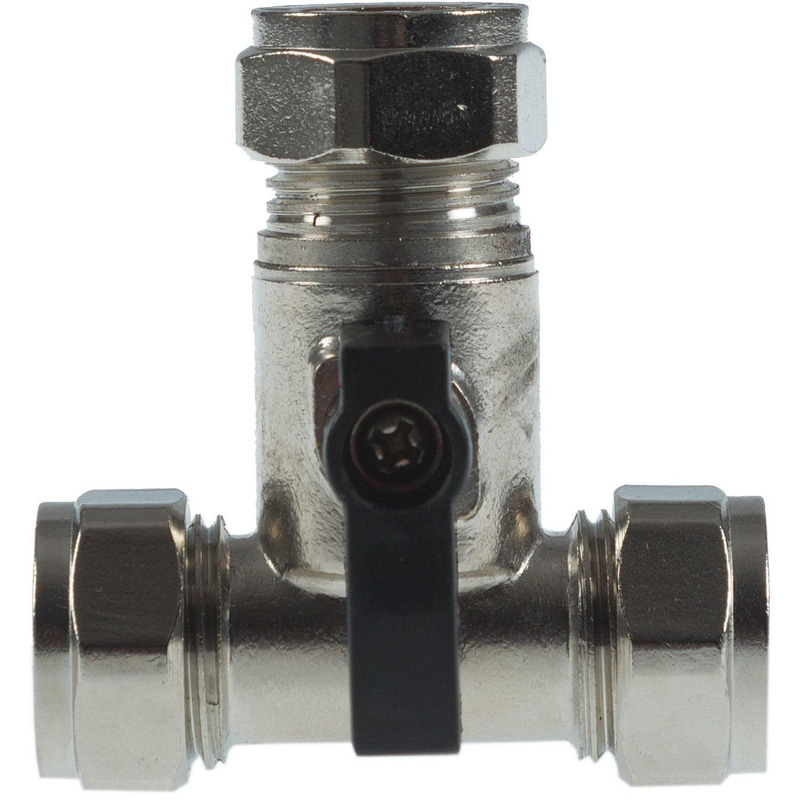
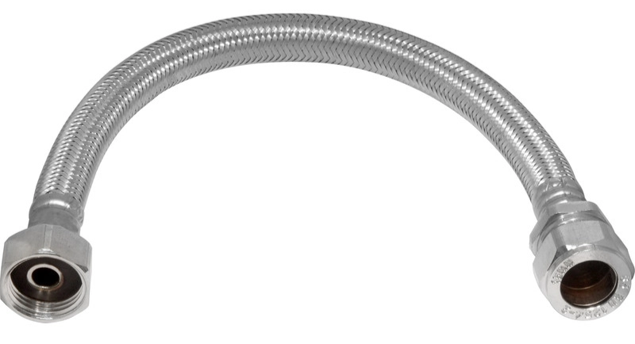
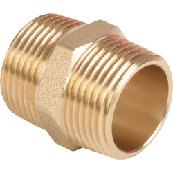
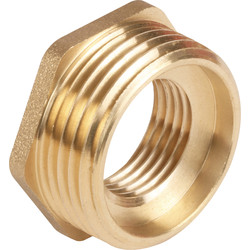

*You want filtered drinking water but you don’t want to be sold ‘Water2’ by Bear Grylls.*

Before you BUY NOW that Black Friday Direct-To-Consumer subscription model Facebook ad ‘recommended by Dr Andrew Huberman’ proprietary $60 water filter cartridge…

Filter housings are standardised, and you can swap them with whatever you like, bought from whoever you like, and you can run them in series in whatever order you like.

These ones come with a ‘taste cartridge’ (activated charcoal) included and are £20 [at Screwfix](https://www.screwfix.com/p/spectrum-drinking-water-taste-control-system-6-9bar/614ew). They also sell a sediment filter cartridge which fits in these. 

I bought two of these packs so I can run one into the other (sediment then charcoal), and I’ll have a spare charcoal filter.

You can buy those stupid little separate taps, or you can get a sensible three-way tap. Cheapest I could find in the UK was around £200 but [Aliexpress sells one for £27.59](https://www.aliexpress.com/item/1005002920111694.html). When that link breaks I’m sure you’ll be able to find an alternative.

## Connections

Tee off your existing cold water supply with a [15 x 15 x 15mm isolating tee](https://www.toolstation.com/isolating-tee/pAF076) placed inline with your existing cold supply.

Connect that to your first filter with a [15mm x 3/4” BSP tap connector](https://www.toolstation.com/flexible-tap-connector/p75235)…

…and a [3/4” BSP hexagonal nipple](/p/0726bc854d514b8ba38b35c9c666487d).

After the filters we need to get up to 1/2” fittings for the tap connector.

If you thought nipples were funny then how about this [3/4” male x 1/2” female bush](https://www.toolstation.com/made4trade-brass-hexagonal-bush/p83555)…

…into [a 1/2” nipple](https://www.toolstation.com/made4trade-brass-hexagonal-nipple/p97735)…

…to the 1/2” tap connector.
