*There are two ways to calculate the age of the universe. They give different answers, and the disagreement is growing.*

This tension comes down to something it’s hard to do in space: measure distance.

When we look into space we can see stars, supernovae, galaxies, clusters of galaxies, black holes, exoplanets and so on. And because light doesn’t travel instantly, the further into space we look, the further back in time we can see.

But what does it mean to look “further into space” if you can’t measure how far away something is?

## The short history of the long history of the universe

In 1908, American astronomer Henrietta Leavitt discovered a group of pulsating Cepheid variable stars that were brighter on some photographs and fainter on others taken at different times. She noticed that the brighter variable stars had a longer pulsation period.

The stars Leavitt measured were all in the Small Magellanic Cloud, so all approximately the same distance from the Earth.

Her conclusion was that these stars have a *"period-luminosity relation"*, where the longer the time period from a Cepheid's maximum brightness to minimum and back to maximum, the greater the intrinsic (actual) luminosity of the star.

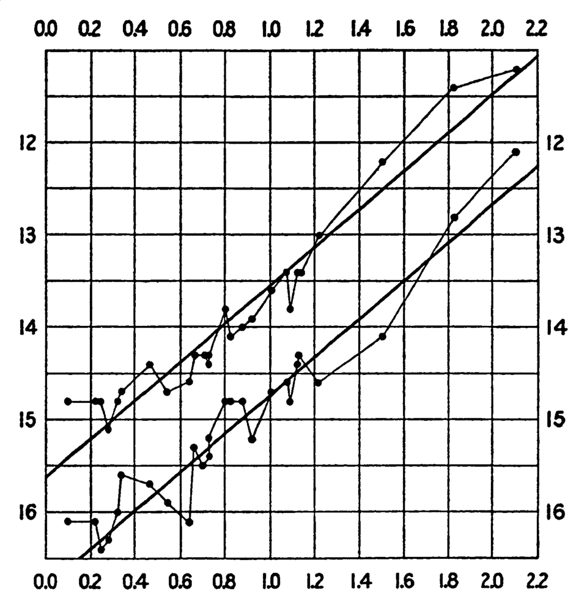

*Image: Plot from a *[*paper*](https://articles.adsabs.harvard.edu/pdf/1912HarCi.173....1L)* prepared by Leavitt in 1912. Magnitude vs log period of 25 Cepheids. There are two trend lines showing the maximum and minimum brightness for each Cepheid.*

Astronomers Ejnar Hertzsprung and Harlow Shapley took this trend one step further by estimating how far various Cepheids were from Earth, using geometric methods like stellar parallax.

This provided a calibration step that allows us to infer the distance to any Cepheid. With this calibration you can measure its period to work out its intrinsic luminosity, and because further Cepheids appear dimmer, the distance can be inferred by comparing the intrinsic and apparent brightness.

By 1928 astronomers had discovered that different objects in space appeared to be moving at different velocities away from us, measured in the redshift of the light from those objects.

Using the 100-inch Hooker Telescope, the world’s largest at the time, Edwin Hubble surveyed the sky for several much dimmer (i.e distant) Cepheids. Hubble also directed his assistant Milton Humason to measure the redshift in the spectra of light from their galaxies.

In a 1929 paper, Hubble presented evidence of another important relation: the further away an object was, the faster it was moving.

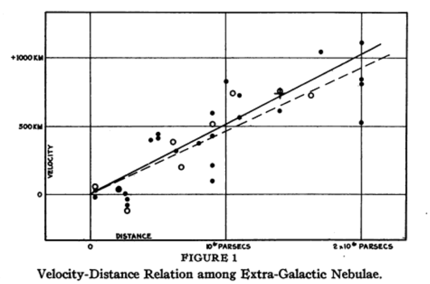

We now know this relation between velocity and distance as Hubble’s law, which defines the Hubble constant, H₀:

Note: this relationship is an approximation that works for short distances. Over longer distances you need to take into account that the expansion rate changes.

It was immediately clear that the universe is expanding. H₀ is a measurement of how fast this expansion is happening, and tracing this expansion backwards in time predicts that the universe had almost zero size at some time in the past. This concept was later elaborated into the modern Big Bang theory.

[Hubble's measurements on 46 galaxies](https://pmc.ncbi.nlm.nih.gov/articles/PMC522427) led to a value for this expansion, H₀ = 500 kilometres per second per megaparsec. 

That number was a problem even then. A (crude) estimation of the age of the universe from this expansion rate, assuming the expansion has always been at the same rate, gives a “Hubble time”, 1/H₀, of about 2 billion years.

Radioactive dating of rocks already showed Earth was older than that — estimates at the time were over 3 billion years.

Hubble had used Hertzsprung and Shapley’s geometric calibration to estimate the distance of his dim Cepheids from their apparent brightness. But he had mistaken bright star-forming regions for individual stars, and so had underestimated how far away they were, leading to an over-estimate of the Hubble constant.

## Stairway to heaven

What Hubble had built is now called a ‘distance ladder’. This principle uses geometry to relate an object's distance to its brightness, so that you can look further into space and use the brightness of the same type of object to estimate its distance.

Objects with a reliable intrinsic luminosity are known as ‘standard candles’.

The SH₀ES (Supernova H₀ for the Equation of State) project, led by Nobel laureate Adam Riess, was established with the primary goal of measuring the Hubble constant.

Modern distance ladders can be built from various combinations of ‘rungs’, in which standard candle calibrates another type of standard candle.

The best chance of an accurate measurement of H₀ is with a ladder reaching as far as possible into space, often with multiple successive calibration steps.

The distance ladder of choice for the SH₀ES group ends with a type of supernova. Supernovae are very bright, so can be detected very far into space. Type Ia supernovae are very good standard candles in that they have an intrinsic luminosity that is reliably calculable.

### **Rung 1: Find the relationship between a Cepheid’s period and its luminosity** 

As we saw earlier, Leavitt’s discovery of Cepheid variables as pulsating stars means we know that the time between pulses — their period — is related to their size and brightness. The period of a Cepheid can range from one to around 50 days.

The distances to Cepheids can be measured by observing the parallax of star clusters that include Cepheids as Earth orbits the Sun. The star clusters used are normally quite close to us — usually within the Milky Way. Their distances from Earth can then be estimated trigonometrically.

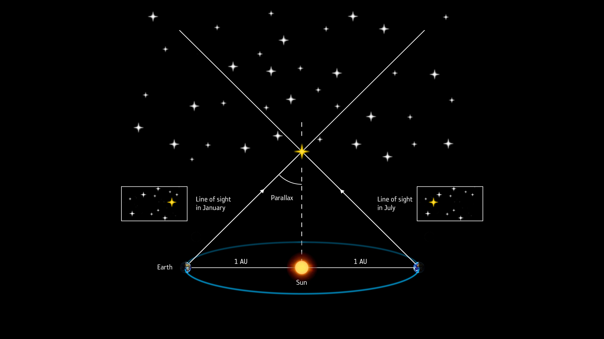

*Image: ESA*

Once the distance is known, scientists can use the apparent brightness of the Cepheid to estimate its intrinsic luminosity. This allows a mathematical relationship to be established between a Cepheid’s period and its luminosity.

### **Rung 2: Use the period-luminosity relationship to calibrate the brightness of Type Ia supernovae**

Using the mathematical relationship established in the first rung between a Cepheid’s period and intrinsic luminosity, various other Cepheids from deeper into space can be analysed. The period of each Cepheid can be used to find its intrinsic brightness, and by comparison to its observed brightness, you can estimate its distance from Earth. This is the same method that Hubble used.

A Type Ia supernova is the thermonuclear explosion of a white dwarf in a binary system. After taking into account their width and colour, Type Ia supernovae are good standard candles, i.e. they always have approximately the same intrinsic luminosity.

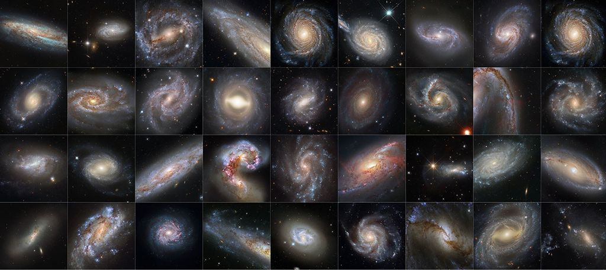

*Image: Hubble Space Telescope images of galaxies that are hosts to both Cepheid variables and Type Ia supernovae. Credit: *[*NASA*](https://science.nasa.gov/mission/hubble/science/science-behind-the-discoveries/hubble-constant-and-tension/)*, ESA, Adam G. Riess (STScI, JHU)*

To make the link between Cepheids and Type Ia supernovae, about 40 galaxies have been identified that host both a well-observed Type Ia supernova and Cepheids. 

At this rung, we can calculate the distance of the galaxy using the Cepheids, and use that distance along with the observed brightness to calibrate the intrinsic luminosity of Type Ia supernovae.

### **Rung 3: Find far-flung Type Ia supernovae and measure their distance and speed to calculate the Hubble constant**

Now that we know the intrinsic luminosity of Type Ia supernovae, it is possible to estimate the distance of several examples from much further away — beyond the range where Cepheids can be detected.

And finally, by comparing the distance of these supernovae with their speed (calculated from redshift), scientists can do what Hubble did and make new estimates of the Hubble constant.

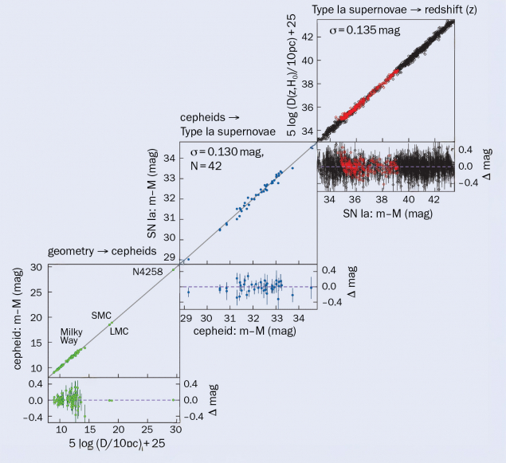

*Image: The SH₀ES distance ladder. Green: geometry calibrates Cepheid magnitude. Blue: Cepheid magnitude calibrates SNIa magnitude. Red: SNIa magnitude calibrates SNIa distance. The distance-redshift relation provides H₀. Credit: Riess 2024*

The calculation of the Hubble constant, as before, is:

Probably the most important recent distance ladder H₀ determination [published](https://arxiv.org/abs/2112.04510) by the SH₀ES collaboration was in 2022, using the Hubble Space Telescope and JWST observations to calibrate 42 Type Ia supernovae, giving a Hubble constant of 73.04±1.04 km/s/Mpc.

(A [2025 update](https://arxiv.org/pdf/2509.01667) adding additional JWST observations found H₀ = 73.49 ± 0.93 km/s/Mpc.)

## Cosmic microwave background

There is another completely different way of measuring the Hubble constant, and it comes from the Cosmic Microwave Background (CMB). But rather than using standard candles to measure distance, the CMB gives us standard rulers.

The CMB was discovered by accident in 1964 at Bell Labs using a horn antenna built to detect radio waves reflected off Echo balloon satellites. Attempts to remove all interference from the receiver included cooling the receiver to 4 Kelvin with liquid helium, and famously removing some pigeons and their accumulated droppings from the antenna.

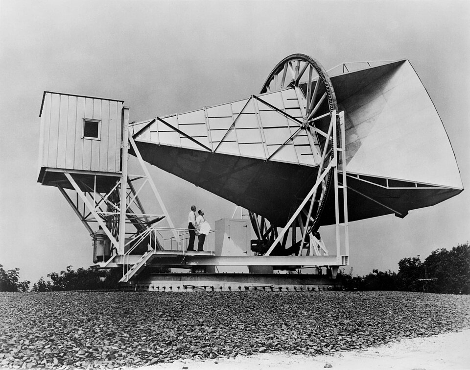

*Image: The *[*Holmdel Horn Antenna*](https://en.wikipedia.org/wiki/Holmdel_Horn_Antenna)* on which Penzias and Wilson discovered the cosmic microwave background. *[*NASA*](https://en.wikipedia.org/wiki/Cosmic_microwave_background#/media/File:Horn_Antenna-in_Holmdel,_New_Jersey_-_restoration1.jpg)

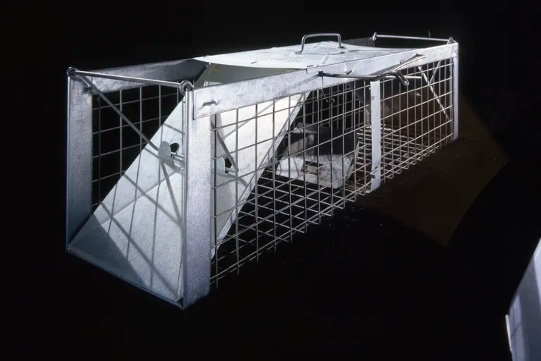

*A pigeon trap, on view at the Air and Space Museum, used by Nobel Prize winners Penzias and Wilson to remove the birds roosting in the radio antenna's large horn. NASM/*[*SI*](https://en.wikipedia.org/wiki/Cosmic_microwave_background#/media/File:Horn_Antenna-in_Holmdel,_New_Jersey_-_restoration1.jpg)* loaned from Robert Wilson*

But no matter what they did, they couldn’t suppress a low, steady, mysterious noise, present day and night, evenly spread over the sky.

And this light can provide another way to measure distances in the sky, infer the Hubble constant, and estimate the age of the universe.

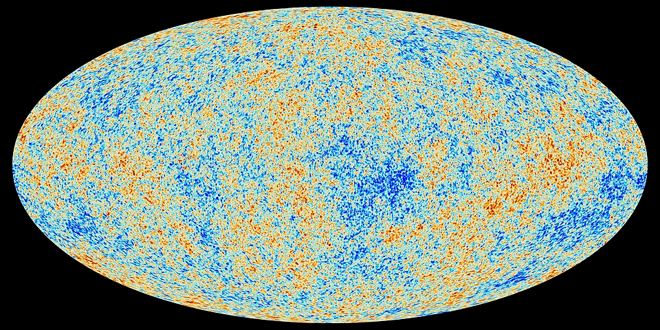

*Image: *[*CMB*](https://en.wikipedia.org/wiki/Cosmic_microwave_background#/media/File:Cosmic_Microwave_Background_(CMB).jpeg.jpeg))* measured by the Planck spacecraft*

The CMB is the oldest light in the universe, released about 380,000 years after the Big Bang. These photons were released from the hot, dense plasma of photons and matter when atoms first began to form in a process called ‘recombination’. The photons of the CMB are still the vast majority of photons in the universe, outnumbering other photons by around 400 to one.

As a result, this light is a snapshot of recombination, when those photons were released from the plasma. Within the CMB, very slight variations — of roughly one part in 100,000 — have been caused by ripples of pressure that were propagating through the plasma before recombination.

These ripples had 380,000 years to travel before they stopped. And because we know the composition of the plasma (it’s possible to calculate it very accurately from the CMB) we can work out how fast the ripples were travelling over that 380,000 years.  This gives a fixed radius for the sound horizon of 0.14 Mpc. This pattern in the CMB has been mapped in detail by satellites like COBE, WMAP, and Planck.

We also know that the CMB temperature was about [2892 K at the drag epoch, compared with 2.7255 K today](https://pdg.lbl.gov/2023/reviews/rpp2023-rev-cosmic-microwave-background.pdf) — which tells us that there has been a stretch of a factor of 1,061. At the time the BAO sound horizon was set, it was about 0.139 Mpc, corresponding to about 147 Mpc today.

What’s amazing — and gives us a standard ruler we can use — is that the ripple structure has also been detected in the in the large-scale distribution of galaxies. Looking deep into space, cosmologists can find statistical evidence that pairs of galaxies are more likely to be found at a certain distance ‘r’. In other words, the pattern of ripples present at the time of recombination has persisted in the matter of the universe.

These ripples are called baryon acoustic oscillations (BAO), and they are very useful for constraining the value of H₀ using the CMB.

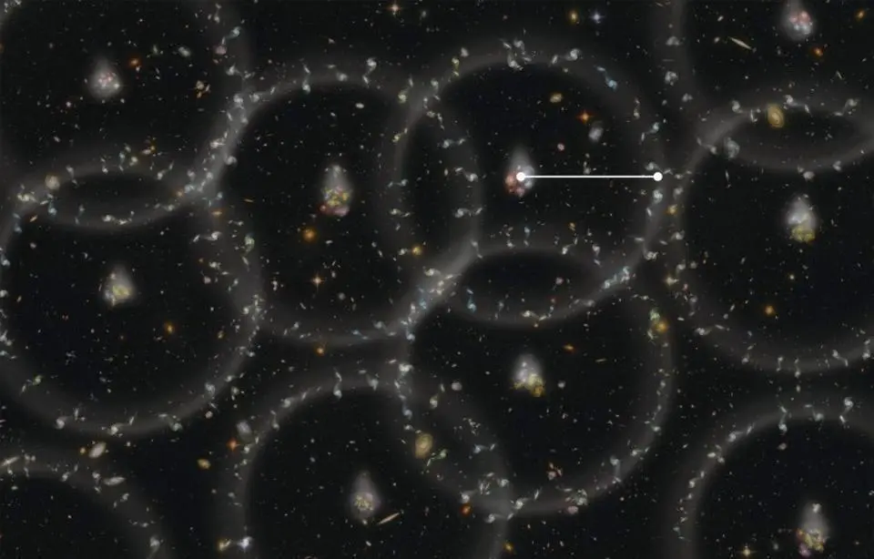

*Image: Illustration of BAO ‘bubbles’ of galaxies. They don’t really look like this, but they are detectable statistically. (A single BAO bubble has potentially been identified, named Hoʻoleilana.) As the universe expands, this characteristic distance expands too, allowing us to measure the Hubble constant as well as the dark matter density and even the scalar spectral index. *[*Credit*](https://www.sdss3.org/press/onepercent.php)*: Zosia Rostomian, LBNL*

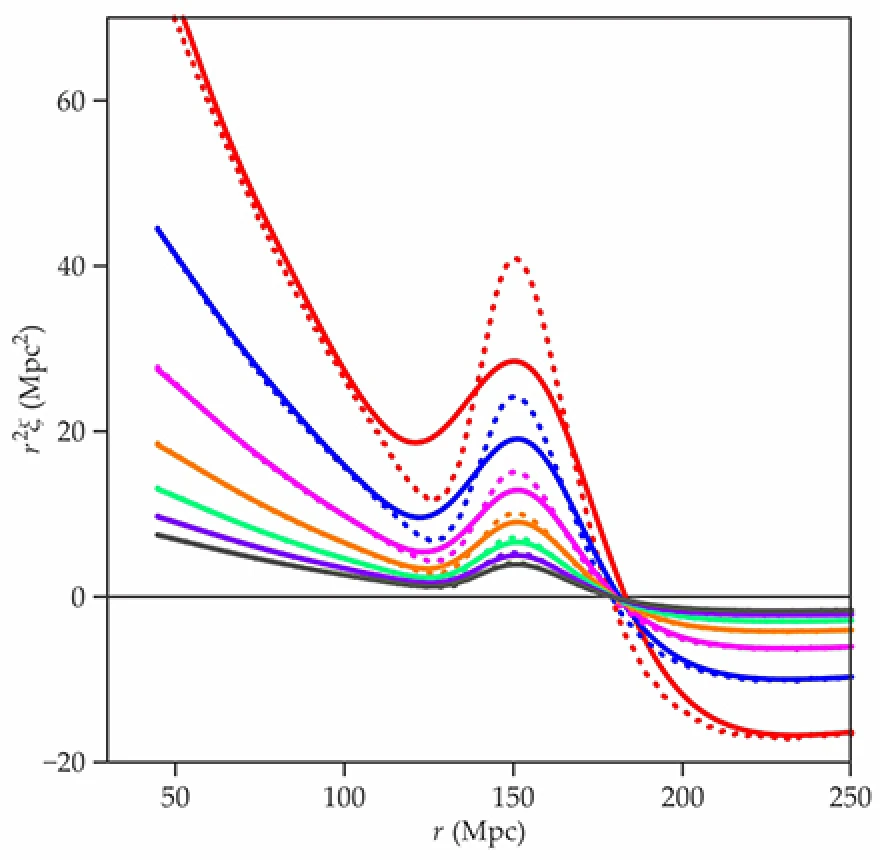

*Image: The bump in the middle of the correlation function shows that galaxy pairs have an increased likelihood to be found at a certain distance ‘r’. This distance is the radius of the sound horizon with expansion taken into account, which is determined from the temperature change of the CMB since recombination.*

Astrophysicists can use this data and the standard ruler to build a 3D map of the universe.

Two measurements are taken for thousands of galaxies:

1. their angular position in the sky

1. their redshift

Using these together, it is possible to build a 3D map that maximises the correlation between galaxy pairs separated by the expanded sound horizon distance of 147 Mpc.

(See the addendum for a potentially more intuitive explanation of this process).

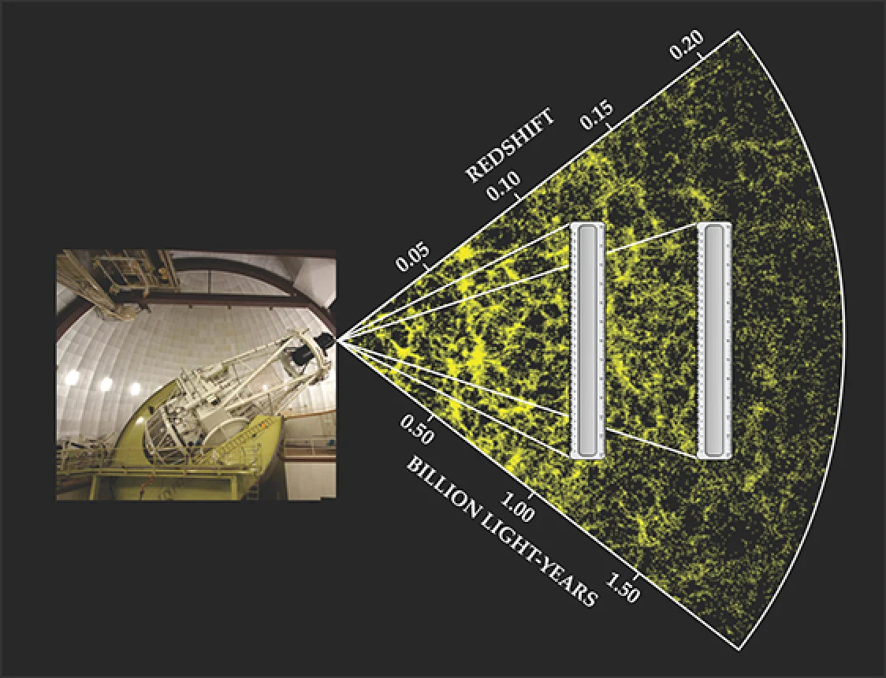

*Image: The BAO sound horizon scale can be thought of as a ‘standard ruler’.* *Although the light from the galaxy surveys is from an earlier, less expanded universe as distance increases, the 3D map plots the bias as being 147 Mpc, so the galaxies are located on the map ‘where they are today’. This idea is called using comoving units. Credit: Ángel López-Sánchez, Australian Astronomical Observatory/Macquarie University.*

From this 3D plot of galaxies, we can compare their distances with their redshifts, once again providing the terms for Hubble’s equation.

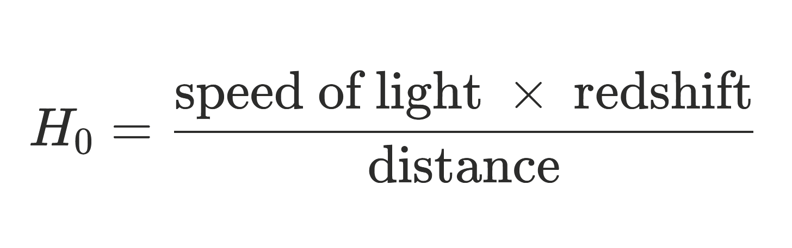

However, this method looks so deep into space that we are measuring the history of expansion H(z), rather than the local rate of expansion H₀.

H(z) is a function that relates the rate of expansion H to redshift z.

We can modify this slightly to measure the Hubble parameter at a redshift by looking at how redshift changes with distance.

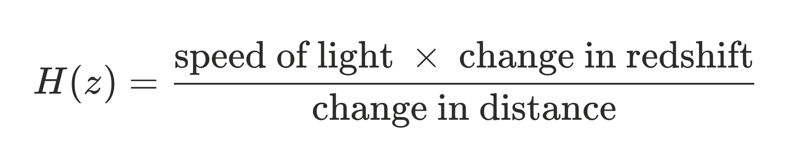

A final analysis of data from the Planck cosmology probe [was released in July 2018](https://doi.org/10.1051%2F0004-6361%2F201936386), providing the most precise measurements of the parameters of the standard ΛCDM cosmological model and determining the Hubble constant to be 67.4 ± 0.5 km/s/Mpc.

## The uncertain expansion

These two methods — the cosmic distance ladder and the cosmic microwave background — both yield seemingly high-confidence estimates of the Hubble constant. 

The only problem is that they disagree with each other. Each of them reports an error range much smaller than the difference between the two. These disagreeing measurements form part of the debate amongst cosmologists, known as the *Hubble tension*. 

And it’s getting worse: the more precise our measurements of either the local universe or the CMB become, the more tightly constrained the estimates get, and the less they appear to agree.

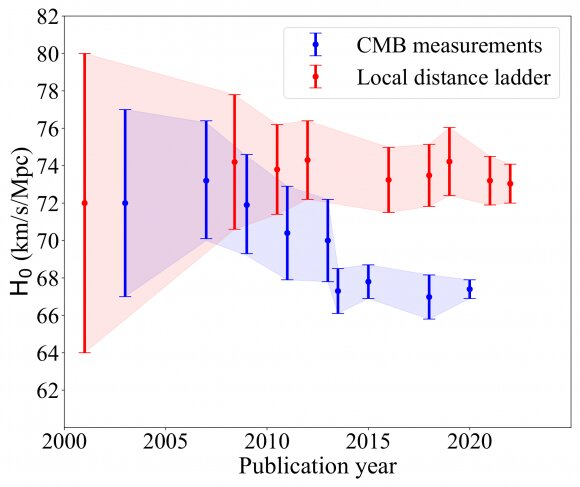

*Image: The Hubble tension is increasing with time. Credit: Perivolaropoulos and Skara *

And these measurements are repeatable: direct measurements of the local, late universe tend to clump around 73 km/s/Mpc, and surveys of the distant, early universe tend to clump around 67 km/s/Mpc.

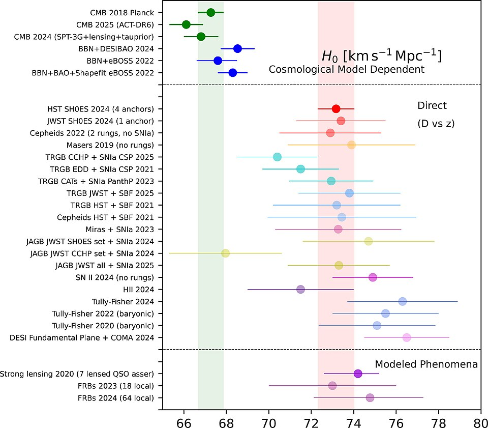

*Image: *[*Summary of H₀ estimates circa 2025*](https://en.wikipedia.org/wiki/Hubble%27s_law#/media/File:1-s2.0-S221268642500158X-gr1_lrg.jpg)

To get an idea of how scientists are thinking about this…

From the Riess 2022 paper: [https://arxiv.org/pdf/2112.04510](https://arxiv.org/pdf/2112.04510)

> The measurement exceeds the Planck+ΛCDM result by 5σ (one in 3.5 million), making it implausible to reconcile the two by chance. […] The source of this long-standing, significant discrepancy between the local and cosmological routes to determining the Hubble constant remains unknown.

 From the Planck 2018 paper: [https://arxiv.org/abs/1807.06209](https://arxiv.org/abs/1807.06209)

> None of the extended models that we have studied in this paper convincingly resolves the tension with the *Riess et al. *value of H₀.

## The uncertain age of the universe

The CMB is an early-universe measurement that requires a model of how the universe expands over time in order to play the tape forwards and find H₀.

On the other hand, the distance ladder provides a direct measurement of H₀, and so to find the age of the universe you need to assume a model, to play the tape backwards.

In particular the CMB provides a lot of information about the composition of the early universe that supports a model of expansion called ΛCDM. This model provides equations for the shape of the expansion over time.

BAO measurements constrain the scale of that expansion shape by matching it to measurements of H(z), leading to an estimate of H₀ and the age of the universe. The distance ladder provides a measurement of H₀ which allows you to calculate the age of the universe.

The two methods disagree on H₀ by around 8%, and this propagates to their respective predictions of the age of the universe.

*Image: Yikes! This looks important and complicated! Well, the value of the integral is close to 1, so the Hubble time factor 1/H₀ in front sets the scale of the age of the universe.*

## So where next?

The basic Hubble relation is deceptively simple: compare the redshift to the distance, and you’ll have it. But cosmic distances are hard to measure.

Most proposals for solving the tension now focus on altering the calibration of either the standard candles (SNIa) or the standard rulers (BAOs).

Perhaps the distance ladder is wrong: maybe the Cepheids or SN1as are a ‘bad batch’ with unusual luminosities or biased redshifts?

Or maybe the BAO scale is wrong: perhaps there is some unusual physics that means we’ve miscalculated the size of the sound horizon when the CMB was emitted (reducing it by 10 Mpc, for example, would lead to a value of H₀ matching the SH0ES data).

But there is also a third way: the link between the early and late universe measurements — the ΛCDM model — could be the problem. This is the most exciting prospect for physicists because it’d mean ‘new physics’: things like* sterile neutrinos*, *dark radiation*, or *early dark energy*, which could all potentially shift H₀.

Arguing about these hypotheticals helps to keep the physicists busy.

*Image: I simply can’t tell how big these bao are…*

## Addendum: a single BAO sphere

The BAO method is fundamentally statistical: it measures a pattern rather than individual spheres. In other words, the pattern is more like the ripples from a handful of gravel hitting a pond than lots of single pebbles.

However, I think it is quite instructive to consider what this methodology involves in terms of a single spherical BAO ‘bubble’ at some depth in space. 

What can we find out about it?

- **radius**: we know from the CMB that its radius is equivalent to the sound horizon, 147 Mpc

- **redshift**: we can measure its redshift from us

- **depth**: we can measure its depth in terms of the gap in redshift from the nearest to the farthest part of the bubble

- **width**: we can measure its width as a number of degrees it takes up in the sky

### Depth: along our line of sight

We can measure the sphere’s depth in terms of redshift.

Now we can use the same equation used by Hubble:

And modify it slightly to measure the Hubble parameter at the bubble’s redshift.

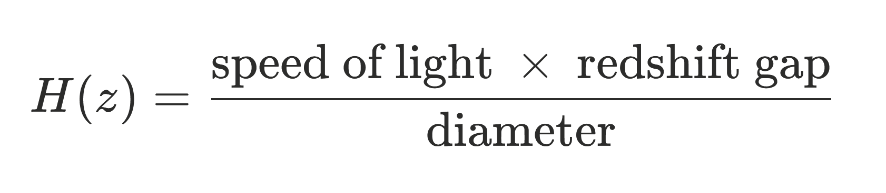

So the rate of expansion, H, at the bubble’s redshift, z, can be found from the speed of light (which we know), the redshift difference (which we can measure), and the diameter (from the BAO).

### Width: perpendicular to our line of sight

Across the line of sight, we can also measure the width of the bubble.

This measurement is not a distance but an angle: the angle the bubble spans across the sky.

Basic trigonometry allows you to find the ratio of the width of the bubble to the distance it is from us. 

With the knowledge that the radius of the bubble is 147 Mpc, it is possible to determine its distance from us.

### Creating a cosmological model

In reality individual bubbles are not easy to identify — each ripple interacts with lots of others, like the gravel on a pond.

These two independent measurements, together with the requirement that the BAO scale be the same across and along the line of sight, provide a way to validate a 3D map of galaxies and check that their positions and redshifts make sense.

These maps are typically produced from cosmological models, and they provide a way to test those models.
